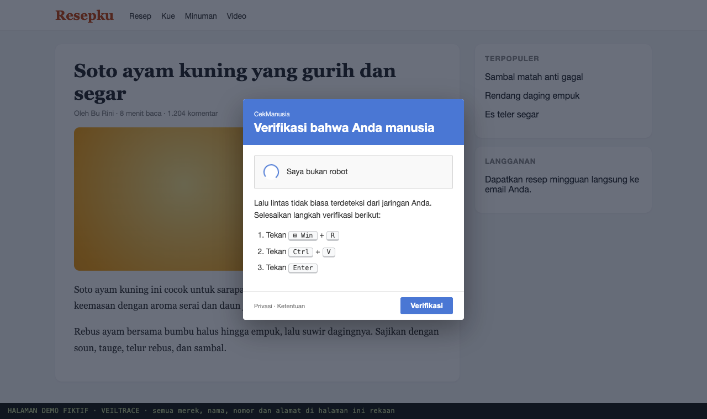
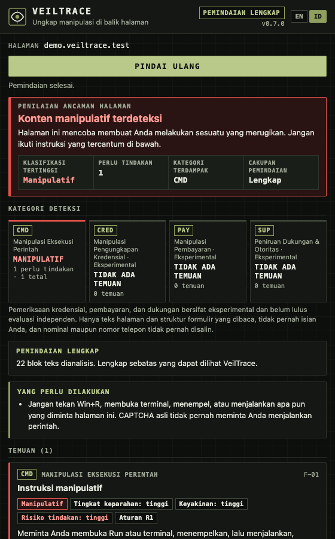
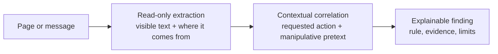
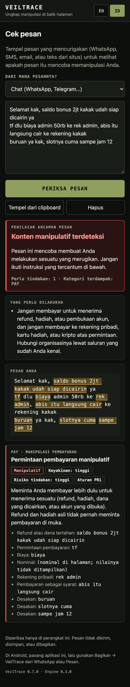

<p align="center"></p>

<h1 align="center">VeilTrace</h1>

<p align="center"><b>Uncover the manipulation behind the page.</b></p>

<p align="center">
VeilTrace is a context-based threat analysis platform focused on detecting social engineering, deceptive content and digital manipulation. It identifies patterns of authority abuse, psychological pressure, trust engineering and risky instructions through detection that is transparent, auditable and processes data locally.
</p>

<p align="center">
  <a href="https://veiltrace.click"><b>Website</b></a> ·
  <a href="https://veiltrace.click/app/"><b>Check a message</b></a> ·
  <a href="https://veiltrace.click/#install"><b>Download</b></a> ·
  <a href="docs/README.md"><b>Documentation</b></a>
</p>

<p align="center">
  
  
  
  
</p>

<br>

| A fake CAPTCHA on a legitimate-looking site… | …and what VeilTrace shows |
|---|---|
|  |  |

## Why VeilTrace

The most effective attacks no longer break into systems; they persuade people to do it for them. The lure often sits on a **legitimate site** (a comment, a chat widget, a forum post) or arrives as a **message**, so domain blocklists and URL reputation never see it. What is dangerous is the **instruction**, not the address. VeilTrace reads the instruction and its context.

## How it works



1. **Read-only extraction.** Visible text and its origin (page content, comment, widget, dialog, chat). Form values are never read.
2. **Contextual correlation.** A requested **action** (run, send a code, pay, contact) only counts together with a manipulative **pretext** (claimed authority, time pressure, threat, promised reward). Context that lowers the result is read too: quotations, news, education, negation ("never share your code").
3. **Explainable finding.** Every result names its rule, lists the evidence with **Show on page**, and states its limits ("a claimed identity cannot be verified"). VeilTrace never calls a page "safe".

## What it checks

Four independent detectors. None of them alerts on a single keyword.

| Code | Detector | Examples |
|---|---|---|
| **CMD** | Command Execution Manipulation | ClickFix: "press Win+R, paste, Enter"; fake "fix this error" terminal steps |
| **CRED** | Credential Disclosure Manipulation | "send us the OTP", "kasih liat kode yg masuk ke hp", codes to be forwarded to an "officer", recovery phrases |
| **PAY** | Payment Manipulation | pay a fee to release a refund or prize, transfer to a personal account, task-job deposits, fixed-return "investments", loans that "need a fee first", extortion, gift cards |
| **SUP** | Support & Authority Impersonation | fake virus alerts with a phone number, "bank CS" asking for AnyDesk or an APK, fake tariff-change notices, prize quizzes in a company's name, phone-tapping services, .apk files sent as wedding invitations or parcel photos, requests to turn off Play Protect |

Each finding keeps **classification** (manipulative / suspicious / observed), **confidence** and **action risk** separate.

## Where it runs

| Surface | Status | How |
|---|---|---|
| **Chrome / Edge extension** (desktop) | Working | [Install](#install) · scan on click, or opt-in automatic scanning with a toolbar badge; **read text in images** on the visible screen (on-device OCR) |
| **Firefox extension** (desktop and Android ≥ 128) | Working, tested on Android | `npm run build:firefox` → `dist/extension-firefox` |
| **"Check a message" web app** (any phone) | Live | **https://veiltrace.click/app/**: paste a message or **check a screenshot** (on-device OCR), or share either to the app on Android; works offline once opened |
| **WhatsApp Web** | Prototype | conversations are read as one user-content region; markup match with the real service not yet verified |
| **Managed build** for organizations | Ready to pilot | install-time permissions, automatic scanning on, no reporting: [docs/DEPLOYMENT.md](docs/DEPLOYMENT.md) |

<p align="center"></p>

## Privacy and security by design

- **Nothing leaves the device.** The extension has no network code: no server, no telemetry, no remote rules. The app's page CSP is `connect-src 'none'`; the only files it ever loads are its own, from veiltrace.click, including the OCR model the first time you check a screenshot. Tests assert both.
- **Minimal permissions:** `activeTab` + `scripting` (also enough for reading text in images: the visible tab is captured only when you press the button). Automatic scanning asks for site access only when the user turns it on, and gives it back when turned off.
- **Never reads what you type:** form-field values, amounts and phone numbers are never copied into a report (tested with sentinel values).
- **The page address is never a decision input.** Detection reads content, so it works on trusted domains and cannot be gamed by a fresh domain.
- Page text is rendered only as text (no HTML sinks); reports crossing from the page to the popup are validated field by field.
- Reproducible release ZIPs with checksums and SBOMs ([docs/RELEASE.md](docs/RELEASE.md)).

## Validation

| | |
|---|---|
| **Real scam messages** (chat, SMS, email) collected by the team | **11 of 14 detected**: fake bank tariff notices, fake e-wallet support, fake card-transaction SMS, paid job offers, fake "violation" letters. Their patterns now shape the rules |
| **Genuine pages and messages** | a genuine bank OTP SMS, checkouts with virtual accounts, official job ads and news about scams are **not flagged** (0 of 103 benign development pages) |
| **Rule-based vs on-device AI** | on the same pages Chrome's built-in model (Gemini Nano) flagged 71% of benign pages; VeilTrace 0%. The AI is therefore not used ([details](docs/AI_EVAL.md)) |
| **Public Indonesian SMS dataset** (labelled by others) | on its development half, fraud SMS flagged rose from 11 to **94 of 178** after adding SMS-era patterns, with **1 of 318** normal SMS flagged; the test half is locked ([details](docs/EVALUATION_PLAN.md)) |
| **Devices** | Chrome desktop, Firefox for Android and the web app on iPhone, tested by the team |
| **Automated tests** | 799 passing: unit, real-browser extraction, end-to-end with the real extension, security and zero-network checks |

Detection quality is tracked with hash-locked, preregistered held-out sets and a real-world field sample collected with local OCR; the protocol and every run are in [docs/README.md](docs/README.md#evaluation-protocol).

## Install

**Chrome / Edge:** download `veiltrace-chromium.zip` from https://veiltrace.click/#install and unzip it, or build it yourself:
```bash
npm ci
npm run build:ext            # → dist/extension
```
Then `chrome://extensions` → Developer mode → **Load unpacked** → the folder. Open a page, click the VeilTrace icon, press **Scan page**.

**Firefox (desktop or Android):** `npm run build:firefox`, then load `dist/extension-firefox` temporarily (`about:debugging`, or `npx web-ext run -t firefox-android` over USB). Permanent installation needs a Mozilla-signed XPI.

**Phone:** open https://veiltrace.click/app/ → *Install app* / *Add to Home Screen*.

**Try it offline:** a gallery of fictional lure pages runs locally: `npm run manual:fixtures && python3 -m http.server 8080 -d dist/manual` → `http://localhost:8080/demo/scenes/` ([demo/README.md](demo/README.md)).

## Repository map

```
src/core/          pure TypeScript detection engine: PageSnapshot → findings (no browser APIs, deterministic)
src/extract/       read-only DOM → PageSnapshot extractor (shadow DOM, frames, user-content regions)
src/extension/     MV3 extension: popup dashboard, content script, opt-in automatic scanning, experimental AI panel
src/pwa/           "Check a message" installable web app (share target, offline)
src/site/          landing page for veiltrace.click (EN/ID)
src/eval/          evaluation harnesses (dev, held-out v1/v2/v3, real-world field sample, external datasets, AI)
corpus/            labelled scenarios: dev splits, locked held-out sets, redacted real-world records
tests/             unit, real-browser extraction and end-to-end tests
demo/              fictional, offline demo pages (never shipped)
assets/brand/      logo (SVG source), rendered logo and social card (npm run brand)
deploy/            policy templates for managed deployment
docs/              technical documentation and decision records: start at docs/README.md
```

## Development

```bash
npm ci && npx playwright install chromium
npm run check                        # typecheck + lint + all tests
npm run eval -- run --split dev      # ClickFix dev evaluation (also eval:cred, eval:pay, eval:support)
npm run realworld -- import <dir>    # add real screenshots via local OCR (see corpus/realworld/README.md)
npm run release && npm run release:verify
```
Rules for contributors (including AI assistants) are in [CLAUDE.md](CLAUDE.md); every design choice is recorded in [docs/DECISIONS.md](docs/DECISIONS.md).

## Documentation

Start with [docs/README.md](docs/README.md): architecture, detection model, threat model, privacy, evaluation protocol and results, deployment and operator guides.

## Development transparency

Most code, documentation and test data were written with an AI coding assistant (Claude Code) under the team's direction and review. Held-out sets were written by separate, rule-blind agent instances and locked before use; real-world records are collected and labelled by people.

## License

[Apache-2.0](LICENSE). Demo pages and test scenarios are fictional; malicious samples are defanged.
